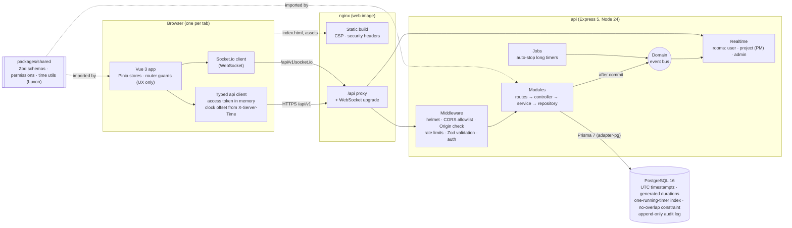

# TEMPO

Time tracking for teams: Super Admin, Project Manager and Worker roles, with time math that stays
correct across devices, timezones and clock skew. Full spec: [PROJECT_SPEC.md](PROJECT_SPEC.md).

## Architecture



- **One contract, two sides.** Request/response shapes, permissions and all time math live in
  `packages/shared` and are used by both the api and the web app, so they can't drift apart.
- **The server decides.** The api validates every input with a Zod schema (unknown keys stripped),
  authenticates, then authorizes in the service layer (role + ownership). The web app only hides
  what a user can't do.
- **The database guards invariants** (one running timer per user, no overlapping entries,
  durations computed by Postgres) in addition to the service checks, so concurrent requests can't
  break them.
- **Live updates** go out after a write commits: services publish domain events, the realtime
  dispatcher reloads the data and emits it to the right rooms.

## Roles

| Role                | Who                               | What they do                                                                                                                                                                                                                   |
| ------------------- | --------------------------------- | ------------------------------------------------------------------------------------------------------------------------------------------------------------------------------------------------------------------------------ |
| **Super Admin**     | Site administrator (2FA required) | Invites people, changes roles, deactivates accounts and signs them out; manages clients and all projects and assigns PMs; edits organization settings; sees all reports, live activity and the audit log. Does not track time. |
| **Project Manager** | Runs one or more projects         | Sees only projects where they are the PM: tasks, workers, rates and budget; live "working now" for their people; reports and exports; approves or returns weekly timesheets (with a comment). Also tracks their own time.      |
| **Worker**          | Tracks time                       | Timer and manual entries on their projects; Today, timesheet, calendar and own reports; submits each week for approval.                                                                                                        |

A PM can't edit a worker's entries; they can only return the week with a comment. The exact
rules per endpoint are in [Permissions](#permissions); the web app's menu and route guards follow
the same role lists (`apps/web/src/router/navigation.ts`).

## Requirements

- Node.js 24 (`nvm use` reads `.nvmrc`). The api runs TypeScript directly via Node's built-in type
  stripping, so there is no api build step.
- Docker with Compose, for PostgreSQL 16.

## Setup

```bash
npm install                                  # also installs the Husky pre-commit hook
cp apps/api/.env.example apps/api/.env
cp apps/web/.env.example apps/web/.env
npm run db:up && npm run db:deploy          # start Postgres, apply migrations
npm run db:seed                              # demo data (wipes the dev database)
npm run dev                                  # Postgres + api + web
```

- Web: http://localhost:5173 (Vite proxies `/api` to the api)
- Api: http://localhost:3000/api/v1/health

`npm run dev -- --no-db` skips Docker if you run Postgres yourself.

## Databases

`compose.yaml` defines two Postgres 16 containers, bound to localhost only:

| Service   | Host port | Database     | Notes                               |
| --------- | --------- | ------------ | ----------------------------------- |
| `db`      | 5433      | `tempo`      | dev data, persisted in a volume     |
| `db-test` | 5434      | `tempo_test` | in-memory (tmpfs), wiped on restart |

Override ports with `POSTGRES_PORT` / `POSTGRES_TEST_PORT`. Start the test DB with
`npm run db:test:up`; stop everything with `npm run db:down`.

Schema: `apps/api/prisma/schema.prisma`. Invariants Prisma can't express are in a raw SQL
migration (`apps/api/prisma/migrations/*_constraints`): the generated `duration_seconds` column,
one running timer per user (partial unique index), no overlapping entries per user (btree_gist
exclusion constraint), `ended_at > started_at`, and an append-only `audit_logs`. Change the schema
with `npm run db:migrate` (creates a migration); the Prisma client is generated on `npm install`.

The Prisma pg adapter is only correct when the Postgres session time zone is UTC, so
`createPrismaClient` forces `TimeZone=UTC` per connection. Always create clients through it.

### Seeded users

`npm run db:seed` creates the users below, all with the password from `SEED_PASSWORD`
(default `TempoDev!2026`), plus 2 clients, 4 projects with tasks and members, 6 weeks of entries
(some crossing local midnight) and running timers for Anahit, Lena and Sofia.

| Email                         | Role            | Time zone        |
| ----------------------------- | --------------- | ---------------- |
| `admin@tempo.test`            | Super Admin     | Asia/Yerevan     |
| `petra.neumann@tempo.test`    | Project Manager | Europe/Berlin    |
| `marcus.reed@tempo.test`      | Project Manager | America/New_York |
| `anahit.petrosyan@tempo.test` | Worker          | Asia/Yerevan     |
| `davit.grigoryan@tempo.test`  | Worker          | Asia/Yerevan     |
| `lena.fischer@tempo.test`     | Worker          | Europe/Berlin    |
| `jonas.weber@tempo.test`      | Worker          | Europe/Berlin    |
| `sofia.martinez@tempo.test`   | Worker          | America/New_York |
| `ethan.brooks@tempo.test`     | Worker          | America/New_York |

### Tests

`npm test` runs unit and integration tests. Integration tests need `TEST_DATABASE_URL`
(`npm run db:test:up`); they drop and recreate that database's schema, so its name must end in
`_test`. `npm run test:unit` runs everything that doesn't need a database.

**End-to-end** (`npm run test:e2e`, Playwright, in `e2e/`):

- It starts its own api (port 3100) and web app (port 5174) against `E2E_DATABASE_URL`. The default
  is `tempo_e2e` on the test Postgres; the name must end in `_e2e`. The database is created if
  missing, then migrated and seeded on every run.
- Run `npx playwright install chromium` once, or set `E2E_CHROME=/path/to/chrome` to use an
  installed browser.
- Covered:
  - starting and stopping the timer, and the timer surviving a reload;
  - a manual entry that overlaps another;
  - submitting a week and its approval;
  - a PM unable to see another PM's project (UI and api);
  - an invite accepted, followed by a sign-in.

## Layout

```
apps/api         Express 5 + TypeScript. routes → controller → service → repository
apps/web         Vue 3 + Vite + Pinia + Vue Router + Tailwind v4
packages/shared  Zod schemas, types and constants used by both sides
```

`@tempo/shared` exports its TypeScript sources directly; Node (api) and Vite (web) both load them
without a build.

## Scripts (from the repo root)

| Command             | What it does                                  |
| ------------------- | --------------------------------------------- |
| `npm run dev`       | Postgres, api (watch mode) and web dev server |
| `npm run lint`      | ESLint (type-aware) across all workspaces     |
| `npm run format`    | Prettier write (`format:check` to verify)     |
| `npm run typecheck` | `tsc` / `vue-tsc` in every workspace          |
| `npm test`          | Vitest in every workspace (needs the test DB) |
| `npm run test:e2e`  | Playwright end-to-end tests (own api + web)   |
| `npm run db:seed`   | Reset the dev database to demo data           |
| `npm run check`     | All of the above, as CI would run them        |
| `npm run build`     | Production build of the web app               |

The pre-commit hook runs lint, format check and typecheck.

## Authentication

All endpoints live under `/api/v1/auth`. Users exist only through invites (no public sign-up).

- **Login** returns a 15-minute access token (send as `Authorization: Bearer …`, keep in memory)
  and sets the refresh token in an `httpOnly; Secure; SameSite=Strict` cookie scoped to
  `/api/v1/auth`. `POST /refresh` rotates it; presenting an already-rotated token revokes the whole
  session family (reuse detection). A second refresh with the same token within 10 s gets `409`
  instead, so two tabs refreshing at once don't log the user out.
- **2FA (TOTP)** is optional for PMs and workers and **required for Super Admins**: their login
  returns `two_factor_setup_required` with a setup token for `POST /2fa/setup` + `/2fa/enable`.
  The seeded admin has no 2FA yet, so the first login enrols it. Recovery codes are stored hashed.
- **Lockout**: 5 failed password/2FA attempts lock the account for 1 min, doubling up to 1 h.
  Unknown emails get the same treatment. Login, refresh, invites and password reset are also
  rate limited per IP / email (in memory: per api instance).
- **CSRF**: endpoints that read or set the cookie require an `Origin` from `CORS_ORIGINS`.
- **Mail** (invites, password resets) is written to `apps/api/.outbox/` as JSON in development.
  The link carries the token in the URL fragment (`#token=…`).
- Logins, failed logins, lockouts, token reuse, invites, password resets and 2FA changes are
  written to `audit_logs`.

## Permissions

Enforced in the api's service layer on every request (the web app only hides UI):

| Area                          | Super Admin | Project Manager                             | Worker                    |
| ----------------------------- | ----------- | ------------------------------------------- | ------------------------- |
| Users, invites, clients       | everything  | —                                           | —                         |
| See projects                  | all         | projects where they are PM                  | projects assigned to them |
| Project name/client/billable  | ✓           | —                                           | —                         |
| Budget, tasks, workers, rates | ✓           | own projects (not other PMs)                | —                         |
| Time entries                  | view all    | view their workers’ entries on own projects | own entries only          |

Anything a user can't see answers **404**, exactly like a missing resource; visible but not
allowed answers **403**. Only the owner edits or deletes a time entry.

## How time handling works

Time is the core of the product, so the rules are strict and live in one place
(`packages/shared/src/time`, unit tested including DST and midnight cases).

1. **Instants are stored in UTC only.** Every timestamp is a Postgres `timestamptz`; there are no
   local time strings or fixed offsets in the database. The Prisma client forces the session time
   zone to UTC.
2. **The server's clock runs the timer.** Start and stop use the api's clock, never a timestamp
   from the browser. A device whose clock is wrong can't start a timer in the past or stop it in the
   future.
3. **Durations come from the database.** `duration_seconds` is a generated column
   (`ended_at − started_at`). The app never adds up client-side counters, so a sleeping laptop or a
   throttled background tab can't lose or invent time.
4. **The live display uses the server's clock as well.** Every api response carries
   `X-Server-Time`. The web app turns these into a clock offset: the median of recent samples,
   corrected for half the round trip. The running timer shows `server now − started_at`, so every
   tab and device shows the same number. An offset over 2 minutes shows a warning.
5. **Days belong to the user's timezone.** Each profile has an IANA timezone (for example
   `Europe/Berlin`). "Today", day and week grouping, timesheets and reports all use it, never the
   device's timezone. If the device is in a different zone, a banner offers to switch.
6. **Entries are split at local midnight.** An entry from 22:00 to 02:00 counts 2 h on each day,
   in totals, timesheets and reports. On DST days a local day is 23 or 25 hours long, and the split
   follows the real wall clock.
7. **Manual entries are local times.** The user enters a date and times in their timezone.
   - A time skipped when clocks go forward is refused with a clear message.
   - A time that happens twice when clocks go back asks which one is meant (before or after the
     change), with both UTC offsets.
   - An end time earlier than the start means the next day.
8. **Rounding is only for reports.** With the organization's rounding rule switched on, each entry
   is rounded once in reports and exports. The rounded time and the money are then shared across
   its days, so every breakdown adds up to the same total. Stored data is never rounded.
9. **Weeks follow the organization.** The week start day is an organization setting; each person's
   weeks begin on that day in their own timezone. Submitted or approved weeks, and entries older
   than the lock period, can't be changed.

## Time tracking

- `POST /timer/start` and `/timer/stop` use the **server clock** (truncated to the second).
  Starting stops the running timer in the same transaction; concurrent starts are serialized by a
  per-user row lock, and the database constraints guard the rest.
- Manual entries are sent as local date + time in the user's profile timezone. Times skipped by
  DST are rejected; times that happen twice need `"ambiguity": "earlier" | "later"`. Entries must
  end after they start, last at most 24 h, end at most 1 minute in the future, not overlap, and
  not fall in a locked period (`lock_after_days`) or a week whose timesheet is submitted/approved.
- A job (every minute) stops timers running longer than the org maximum (default 12 h) at exactly
  start + max and flags them `AUTO_STOPPED`.

## Timesheets, reports and administration

- **Timesheets** (`/timesheets`): a user submits the week containing a date (`POST /timesheets/submit`);
  weeks start on the org week start day, in the owner's timezone. A submitted or approved week
  is read-only for its entries and timer; a rejected week (rejection needs a comment) can be
  edited and submitted again. Approved weeks stay read-only even if approval is later switched off.
  A PM reviews the workers on projects they manage, and an admin reviews anyone. Nobody
  reviews their own week. A PM sees time on other projects only as an unnamed total.
- **Reports** (`GET /reports`, `/reports/export.csv`, `/reports/export.pdf`): completed entries
  only, clipped to the range and split at local midnight in the **requesting** user's timezone.
  With `?round=true` the org rule is applied once per entry; the rounded time and the money are
  shared across the entry's days so every breakdown adds up to the same total. Amounts are
  billable time × the worker's hourly rate on the project, shown to admins and PMs only. Admins see
  everything, PMs their projects, and workers their own time. The CSV has one row per entry per
  day, with formula injection neutralized. The PDF is generated without dependencies (standard
  Helvetica, so characters outside Latin-1 print as "?").
  `GET /reports/entries` pages the same rows (newest first) for the detailed table, and
  `GET /reports/options` lists the projects, tasks, people and clients the caller may filter by
  (exactly their reporting scope).
- **Budget usage** (`GET /projects/usage`, `GET /projects/:id/usage`): all-time and this-week
  time per project (and per member), for admins and the project's PM. Unlike reports, a running
  timer counts up to "now", so dashboards stay live. "This week" uses the viewer's timezone and
  the org week start day.
- **Approvals:** `GET /timesheets?reviewable=true` lists only timesheets the caller may review
  (never their own).
- **Settings** (`/settings`) and **audit log** (`GET /audit-logs`, filters: `actorId`, `action`
  (exact or a prefix ending in "."), `targetType`, `targetId`, `from`/`to` local dates) are
  Super Admin only. Audit rows are stamped with the server clock.

## Realtime (Socket.io)

- Endpoint path `/api/v1/socket.io`. Connect with `auth: { token: <access token> }` from an allowed
  Origin. The server checks the token like any request (live session, active user, 2FA for
  admins) and closes the connection when the token expires (`auth:expired` first). Reconnect with a
  fresh token.
- **Rooms are server-side only.** Clients send no events. Every connection is in its user's room
  and its session's room. PMs are also in the rooms of projects they manage (PM role + PM
  membership, read from the database), and Super Admins in the `admin` room. Role or membership
  changes move open connections at once. Logout, "log out everywhere", password reset and
  deactivation close them.
- Events (types in `packages/shared/src/realtime`):
  - `entry:saved`, `entry:deleted`, `timesheet:changed`: to the owner's tabs and devices.
  - `activity:snapshot`, `activity:update`: "working now", for PMs (their projects only) and admins.
    A PM whose worker moves to another project sees `running: null`, not where they went.
- Services publish domain events on an in-process bus after their writes. Running several api
  instances needs a shared Socket.io adapter (e.g. Redis), which is not set up.

## Web app

- **Auth:** the access token lives in memory only. The api client refreshes it once on a stale
  401 (single flight, serialized across tabs with the Web Locks API) and retries the request.
  `INVALID_CREDENTIALS` is never retried. Every response's `X-Server-Time` feeds the clock store,
  so the live timer is `server now − startedAt` even on a device with a wrong clock. A clock off
  by more than 2 minutes shows a warning.
- **Live sync:** one Socket.io connection (WebSocket only) per tab. Entry, timer and timesheet
  events update the same stores that local actions use, so tabs and devices agree.
- **Route guards** (`src/router/guards.ts`) are UX only. Pages for other roles show 404, like the
  api. The sidebar menu comes from the same role list.
- **Design:** tokens in `src/styles/tokens.css` (light/dark, indigo accent, green for
  running). Inter and JetBrains Mono are self-hosted from `public/fonts` (OFL; licenses there).
  Motion is CSS transitions plus GSAP, and is fully off with `prefers-reduced-motion`.
- **Shortcuts:** `S` starts/stops the timer, `N` adds a manual entry (not while typing).
- **PM pages** (`src/pages/manage`, admins see them for every project):
  - Dashboard: live "working now" (from the socket), budget bars and pending approvals.
  - Projects list and detail: members, rates, tasks and budget.
  - Reports with filters, charts, breakdowns, paged entries and CSV/PDF export.
  - Approvals with a review dialog.
  - Budget numbers add the running timers' time since the last fetch, so they tick; they reload
    when someone starts or stops.
- **Admin pages** (`src/pages/admin`):
  - Users: search, filters, invites, role change, deactivate/reactivate, sign out everywhere.
  - Clients & projects, with PMs assigned on the project page.
  - Organization settings: only changed fields are sent, so the audit log shows real changes.
  - Audit log with filters and a field-by-field before/after view.

## Continuous integration

`.github/workflows/ci.yml` runs on pushes to `main` and on pull requests:

- **check:** lint, Prettier check and typecheck, then unit + api integration tests against a
  Postgres 16 service container, then `npm audit` of the runtime dependencies.
- **e2e:** the Playwright suite against its own Postgres service. On failure, the report and
  traces are uploaded.
- **docker:** builds the production images.

## Deployment (Docker)

Build from the repository root:

```bash
docker build -f apps/api/Dockerfile -t tempo-api .                    # api runtime
docker build -f apps/api/Dockerfile --target migrate -t tempo-api-migrate .
docker build -f apps/web/Dockerfile -t tempo-web .                    # nginx + static build
```

`compose.prod.yaml` wires Postgres, a one-off migration, the api and the web together; secrets
come from `.env.production`.

- **api:** Node 24 Alpine; runs as the unprivileged `node` user, with production dependencies only
  and a health check. Migrations run from the separate `migrate` target, which has the Prisma CLI.
- **web:** nginx serves the build and proxies `/api`, including the Socket.io WebSocket, to the api,
  so the browser sees one origin.
  - It sends a strict Content-Security-Policy (`script-src 'self'`, no inline scripts), HSTS,
    `nosniff`, a referrer policy and `frame-ancestors 'none'`.
  - Hashed assets are cached for a year; `index.html` is always revalidated.
- **In production** (`NODE_ENV=production`) the api refuses to start with the example secrets
  from `.env.example`, or with `WEB_APP_URL` or `CORS_ORIGINS` that aren't https.
- Set `TRUST_PROXY` to the number of proxies in front of the api (1 behind the web image), so that
  rate limits and the audit log see real client IPs. With 0 behind a proxy, every user shares one
  IP: one person's failed logins would rate-limit everyone, and every audit row would show the
  proxy's address.
- Mail is still written to the outbox directory (a volume in the compose file). Connect a mail relay
  before inviting real users; the api logs a warning about this at startup in production.
- Rate limits and live updates are kept in process memory, so run **one api instance**. Scaling out
  needs a shared store (for example Redis) for both.

## Security

Reviewed against the OWASP Top 10 (2021):

- **Access control:** checked on every request in the service layer (role + ownership). Anything a
  user can't see answers 404. A permission matrix test covers every role × endpoint, and the e2e
  suite covers cross-PM access. The "last active Super Admin" rule is enforced in a transaction
  under an advisory lock.
- **Cryptography:**
  - Passwords use argon2id (OWASP parameters).
  - Refresh, invite and reset tokens are random and stored only as SHA-256 hashes.
  - TOTP secrets are encrypted with AES-256-GCM.
  - Access tokens are HS256 with a fixed header, so `alg: none` or algorithm confusion is
    impossible.
- **Injection:** Prisma queries throughout; the few raw queries are tagged templates
  (parameterized). CSV cells are protected against formula injection, and PDF strings are escaped.
- **Design:**
  - Rate limits on login, 2FA, refresh, invites, password reset, report reads and exports.
  - Account lockout with exponential backoff; unknown emails get the same lockout and timing.
- **Misconfiguration:**
  - helmet, a CORS allowlist, an `Origin` check on cookie endpoints, `no-store` on api responses.
  - Production refuses the example secrets and non-https URLs.
  - The web image sends a strict CSP.
- **Vulnerable components:** `npm audit` of the runtime dependencies runs in CI (currently clean).
- **Authentication:**
  - 2FA is required for admins, with replay protection on codes.
  - Refresh tokens rotate, with reuse detection that revokes the whole session.
  - Changing or resetting a password and deactivating an account end other sessions, including
    live connections.
- **Integrity:** the audit log is append-only (a database trigger) and records before/after
  values, IP address and user agent.
- **Logging:** logins, failures, lockouts, permission changes, entry edits, approvals and setting
  changes are audited. Request logs never contain bodies, tokens or query strings.
- **SSRF:** the api makes no outbound requests based on user input.

## Api conventions

- Environment variables are validated with Zod at startup; the api exits with a list of invalid
  variables (values are never printed). See `apps/api/.env.example`.
- Every response carries `X-Server-Time` (UTC epoch ms, stamped just before headers are sent) and
  `X-Request-Id`. Both are exposed to allowed CORS origins.
- Errors always look like `{ "error": { "code", "message", "details?" } }`. Throw an `AppError`
  subclass from `apps/api/src/errors/app-error.ts`; anything else becomes a generic 500.
- Logs are structured JSON (pino), one line per request, without bodies, headers or query strings.
